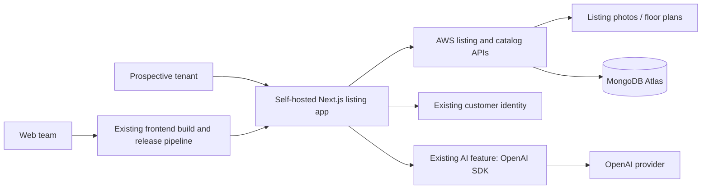
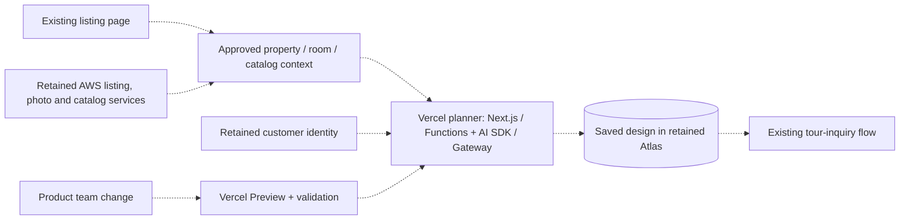
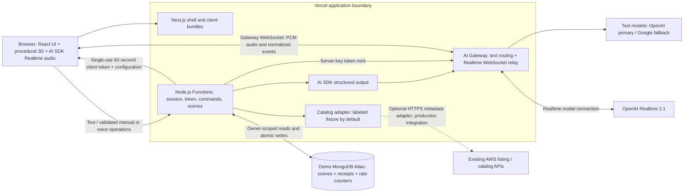

# Architecture and operating decisions

VoxBuild **augments** a rental platform with interactive planning and **connects** that experience to the customer's existing data. Recommend a scoped planner pilot using Next.js/Functions, Preview Deployments, AI SDK, and AI Gateway. Vercel handles delivery and AI integration for the new slice; the existing listing application, its OpenAI SDK feature, AWS services, Atlas, and customer identity stay in place.

## Customer starting point

This fictional long-term rental marketplace is in the category of Apartments.com or StreetEasy; it is not a claim about either company's deployment. Assume a self-hosted Next.js listing application, an existing AI feature using the OpenAI SDK, AWS listing/catalog/photo services, MongoDB Atlas, customer identity, and a custom release pipeline. Prospective tenants infer room layouts from photos and ask suitability questions before requesting a tour. Review-environment queues, release handoffs, and provider plumbing consume engineering capacity that could improve that experience. Validate those assumptions before assigning savings or recommending wider migration.

The business hypothesis is that a clearer understanding of a property increases qualified tour requests. That is a pilot hypothesis, not a demonstrated conversion gain. Confirm where the customer currently loses tenants and baseline the existing review/release effort. If discovery does not confirm a delivery bottleneck, pilot Gateway alone on the existing host and OpenAI SDK instead, subject to compatibility checks. The four-choice planner pilot is the recommendation for the assumed combined delivery and AI friction; the existing application's SDK need not change.

## Proposed customer integration

Dashed connections show the proposed customer journey and delivery integration. An eligible listing opens the planner with approved room dimensions and catalog metadata; the customer identity authorizes access to its saved design, and a tour inquiry remains in the existing flow. Confirm which saved-design reference and consent belong in that inquiry before implementation. The customer retains ownership of listings, photos, catalog, identity, and data. The demo does not implement listing ingestion, customer SSO, or tour attribution.

## Implemented proof and integration seams

The implemented core uses six authored room presets and a 14-SKU catalog fixture; no AWS call occurs unless the optional adapter is configured. Its newly provisioned external Atlas cluster represents the customer's retained database. The real boundary is evidenced by the **November 12** production regression: [10 storage checks](evidence/storage-refinement-production.json), [14 room/artwork checks](evidence/decor-refinement-production.json), and [14 semantic text checks](evidence/semantic-refinement-production.json), all passing with the relevant persisted rereads. The [Gateway voice integration check](evidence/gateway-voice-local.json) additionally exercised a real Realtime tool call through the local HTTP command API and an Atlas commit before audio output; its synthetic text input does not verify browser microphone capture. Authored layouts establish a concept preview, not a fit guarantee for a renter's own furniture. An explicitly marked local sample does not satisfy the live-boundary requirement.

| Vercel choice | Customer value | Trade-off and scope |
| --- | --- | --- |
| Next.js on Vercel Functions | One delivery surface for UI and short request handlers; SDK and database access stay server-side | Node.js database connectivity and model waits need regional placement, timeouts, and bounded concurrency. Validate the account's Fluid Compute settings during deployment. |
| AI SDK | Typed text plans plus normalized Realtime audio/events avoid maintaining independent provider protocol code for the demo | Schema-valid output can still be semantically wrong; domain validation, save coordination, and evaluation remain application responsibilities. |
| AI Gateway | Text and voice share a Gateway access and accounting surface; text supports model routing, fallback policy, and returned usage/routing evidence | Realtime uses a WebSocket relay and a server API key for token minting. Active voice failover/resume is not implemented; serving-provider identity and per-event dollar cost are unknown without returned metadata. |
| Preview Deployments | Review the complete change before exposing it to tenants | Preview data and credentials must be isolated; the production canary policy is an operating proposal until exercised. |

The presentation proof follows the same decision: edit a room to show bounded AI behavior, inspect returned Gateway routing/cost to show managed model access, reload to prove the external save, and show a Preview URL to demonstrate review access. These prove capabilities, not time saved or conversion uplift. The pilot compares review/release effort and operating cost with the assumed starting point, then tests qualified tour inquiries and suitability-support contacts through the proposed customer journey.

Blob and Workflows are intentionally absent from the core. Add Blob for a future photo-upload flow. A durable workflow becomes relevant for long-running reconstruction or human approval, rather than a single bounded furniture edit.

## Rendering, caching, and network placement

Next.js supplies the document/UI shell and JavaScript. The WebGL canvas is dynamically imported with server rendering disabled. The browser draws meshes from validated scene JSON; it does not execute model-generated code or fetch remote GLB assets. Private scene/session/command responses use `no-store`. Public catalog responses use a five-minute shared cache window; the optional external metadata fetch has five-minute revalidation and a catalog tag. This implementation does not claim Cache Components or streamed model output: a complete validated plan is returned before the scene changes.

Place Functions near the selected Atlas region to reduce database round trips; measure the actual deployed path before declaring a region SLA. The demo can cross a public TLS endpoint with an authorized Atlas access list. A production private-network requirement calls for a supported Atlas networking tier and Vercel Secure Compute/static egress design, validated against the customer's cloud, plan, and residency policy. Selecting a Function region alone does not constrain Gateway media routing or model-provider processing geography.

The provisioned demo has a new VoxBuild Atlas project and a Free/M0 cluster on AWS `US_EAST_1`. Production uses `voxbuild`; Preview uses `voxbuild_preview`. Each has a separate session secret and a database user granted `readWrite` for its application database, scoped to this cluster. Provisioning created `owner_updated` on scenes (`ownerId: 1, updatedAt: -1`) and the rate-counter TTL index on `expiresAt` with `expireAfterSeconds: 0`.

For dynamic Vercel egress, the user explicitly approved an Atlas `0.0.0.0/0` access-list rule. It has **no automatic expiry**. TLS and database authentication remain required, but the network endpoint is broadly reachable. This is an accepted demo constraint, not the proposed production network posture. Remove the rule explicitly after the demo; continued operation requires an authorized replacement connectivity plan.

## Command correctness and durability

Every mutation has a scene ID, command ID, expected revision, and up to 12 operations. The shared schema permits furniture add/move/recolor/rotate/remove, `set_environment`, `move_artwork`, and `set_artwork`. Dimensions and colors come from a finite versioned catalog. The domain engine rejects unknown SKUs/IDs, unsupported colors, excessive object counts, and rotated furniture outside the room, floor, or ceiling.

The provider-facing schema uses an `anyOf` operation union and plain fields for compatibility across the selected text models and Realtime tools. Descriptions explain the intended bounds, but they are not enforcement. The server parses model output through the strict domain schema before applying any operation or committing state. This separation avoids depending on provider support for every JSON Schema constraint.

The shared store executor loads a scene using the signed session owner, validates a detached copy, and commits the next revision plus command receipt in **one MongoDB document update**. The compare-and-swap filter includes owner, expected revision, and absence of the command ID. Competing writes cannot silently overwrite one another. In that executor, a repeated receipt with the same payload returns the current canonical scene; reusing the ID for a different payload is rejected. The last 128 receipts are retained; an older retry still carries its old revision and cannot reapply after receipt eviction.

The `set_environment` operation selects one of six allowlisted palettes. It updates wall/floor color fields in the same atomic scene write; the renderer derives distinct daylight, overcast, morning, coastal afternoon, sunset, or night lighting. It preserves furniture, artwork, window placement, and room dimensions. The catalog contains fourteen supported SKUs; the picker contains five furnished rooms and an empty gallery. City loft is no longer offered, while existing saved lofts remain readable as saved rooms.

Optional `room.windowLayout` and `room.artworks` fields describe fixed window arrangements and editable wall art. Each preset uses a different window arrangement; five procedural artwork designs need no remote assets. A painting has an ID, design, wall, horizontal offset, and center height. The shared geometry helper defines window openings for both rendering and placement validation. `move_artwork` keeps the complete frame within the wall and clear of windows and other paintings; `set_artwork` replaces its design. Both use the same revision-checked atomic save as furniture. Paintings use selection and wall controls, not free dragging; windows are part of the room preset.

Legacy scenes without the optional fields render the original window and painting. The first painting edit materializes that scene's effective artwork array; loading alone does not rewrite it. `schemaVersion: 1` remains readable by the current application, but the previous strict schema does not accept the new optional keys. A rollback must retain readers for these fields and the expanded SKU set, or explicitly migrate records first; restoring an old deployment alone is not a safe data rollback.

MongoDB fits the access pattern because the bounded room is the unit loaded, validated, and saved. Its single-document atomicity covers the scene, revision, and receipt together; the configured `w=majority` requests majority write acknowledgement. This does not make model generation, rate-limit counters, and scene persistence one ACID transaction. [MongoDB atomicity](https://www.mongodb.com/docs/manual/core/write-operations-atomicity/), [write concern](https://www.mongodb.com/docs/manual/reference/write-concern/).

PostgreSQL is a valid alternative: one scene row with a `jsonb` payload and a revision condition can implement the same pattern, without normalizing every furniture property into separate tables. PostgreSQL also supports JSON indexing. In a customer already using Postgres, reuse it unless a measured requirement justifies another database. The reference scenario retains Atlas; voice and 3D rendering do not themselves require MongoDB. [PostgreSQL JSON types](https://www.postgresql.org/docs/current/datatype-json.html).

The production storage run passed all ten checks: owner reads/listing, foreign read/write rejection, schema rejection, atomic rejection of a valid recolor followed by an invalid move, duplicate concurrent delivery, command-ID reuse rejection, competing writes, and a canonical winner reread. The run created one isolated fixture, committed exactly two revisions, and preserved all unmentioned objects. This establishes those live storage invariants for the recorded run; it does not establish general uptime or browser voice behavior.

Endpoint behavior is narrower than this shared executor guarantee. Manual and voice operations call `/api/commands`; an identical payload retry is idempotent while its receipt is retained. Text calls `/api/scene-agent`, which checks the expected revision **before** generation and receipt lookup. If a text edit committed but its HTTP response was lost, the same request returns `409 REVISION_CONFLICT` on retry. Reload the saved room to recover the accepted state, then issue a new request only if a further change is needed. There is no prompt/result ledger, and the complete text-generation endpoint is not idempotent.

There is no silent storage fallback. A database error retains the last acknowledged browser state and surfaces an error. A request timeout is ambiguous: the write may have committed, so reload the canonical scene before retrying. Accepted scene state survives deployments; an in-progress model generation or Realtime WebSocket connection does not. There is no durable agent orchestration or automatic replay of unfinished conversations.

Furniture-to-furniture collisions and circulation clearances are not authoritative server checks. The model receives placement guidance and manual addition searches for a clear spot, but the product remains a conceptual preview. A production fit claim requires verified dimensions, collision/clearance validation, and accessible paths.

## Voice and security

Only an explicit click requests microphone permission. The browser posts a scene ID to same-origin authenticated `/api/realtime-token`. The route verifies ownership, loads canonical scene context, enforces voice admission limits, and uses the server-only `AI_GATEWAY_API_KEY` to mint a model-scoped, single-use Gateway token with a 60-second connection window. The ordinary key never reaches the browser. Gateway's Realtime mint endpoint rejected OIDC-only authentication with 403 during preflight, even though ordinary text requests support OIDC.

The browser connects by WebSocket to Gateway, which relays audio/events to `openai/gpt-realtime-2.1`; the AI SDK normalizes the protocol and PCM audio handling. The 60 seconds is token validity for starting the connection, not the session duration. The server supplies scene instructions and tools, but those are client-applied session configuration, not a token-enforced authorization policy. `/api/commands` remains the authoritative ownership, schema, revision, and placement boundary.

Voice only executes completed, validated function calls, with duplicate suppression and serialized edits. Planning responses are text/tools; an audio continuation is requested after the command acknowledgement. This adds a second Realtime response and latency but prevents the normal workflow from speaking a success before the save result. English captions use `gpt-4o-mini-transcribe` with `language: en`; the Realtime model interprets the audio independently of that displayed transcription. Server VAD handles barge-in; stale queued speech is suppressed. Disconnect and unmount release microphone tracks. The five-minute browser timer is a UX limit, not an authoritative provider billing cap. See the [Gateway Realtime documentation](https://vercel.com/docs/ai-gateway/modalities/realtime).

On November 12, the [new local Gateway voice report](evidence/gateway-voice-local.json) exercised an anonymous HTTP session, token mint, a real Realtime completed tool call, `/api/commands`, and a canonical Atlas reread at revision 1. The sofa became `#687761`; 304,800 bytes of audio followed the accepted commit, with no audio before it. Input was synthetic text sent to the Realtime session, not a browser microphone. Separately, the user confirmed microphone edits, spoken replies, interruption, and Stop on [Gateway voice Preview `1587666`](https://voxbuild-gjpqu40ux-kyu-hun-lees-projects.vercel.app). That browser confirmation is user-reported; end-to-end latency and unmount cleanup remain unmeasured. The requested model and Gateway route are known; the report does not establish a serving-provider identity or per-event dollar cost.

The following voice observations predate the Gateway migration and describe the former direct-OpenAI transport. They remain historical evidence, not proof of the new browser path.

Two real direct-provider checks on October 19, 2026 accepted the then-current session configuration over **server WebSocket**, using synthetic text and a three-second TTS fixture respectively. Both produced a completed `response.done` containing a completed function call, and the emitted sofa recolor passed the strict schema and local scene engine. The audio fixture also triggered server VAD and input transcription. The provider accepted the coordinator's scene-context → correlated tool-result → audio-continuation order, preserving `metadata.phase: speech` and emitting no additional tool call. [Text evidence](evidence/realtime-text-compatibility.json), [audio evidence](evidence/realtime-audio-compatibility.json).

These were bounded compatibility checks with an explicitly labeled in-memory fixture result (`persistence: none`) and **zero Atlas writes**. They did not exercise the browser, microphone, SDP/WebRTC negotiation, playback, interruption, or database-backed executor. The audio sample's completed tool arrived 670 ms after the service's speech-stopped event; it is one observation, not a p95 or end-to-end latency claim.

The user later tested the actual deployed microphone flow and reported, “It changes the sofa and speaks back.” This is **user-confirmed speech → visible edit → spoken acknowledgement**, not agent-instrumented evidence. The user also confirmed interruption with a new spoken edit and that Stop releases the active microphone. These are manual observations. A subsequent agent browser check fully reloaded the stopped session and retained the blue sofa at revision 6, position x=0/z=-2.13, rotation 0, with Cloud saved status. Browser timing and unmount cleanup remain unverified.

Anonymous sessions use a signed, HttpOnly, SameSite cookie and a seven-day expiry. Scene ownership is enforced in database filters. Mutating routes require same origin. Request bodies, operation counts, provider timeouts, and Atlas-backed rate counters are bounded. These controls are appropriate for an isolated public demo; production should add customer identity/authorization, account-wide provider budgets, stronger abuse protection, retention/deletion policy, and audit integration. Anonymous cookie loss means loss of access to that design.

Normal voice admission allows **20 starts/hour per visitor and 100/day globally**. Normal text generation allows **40 requests/hour per visitor and 400/day globally**. The November 12 interview allowance raises voice to **100/hour and 500/day**, and text to **200/hour and 2,000/day**; it ends automatically at **November 13, 2026, 05:00 UTC**, midnight in New York. These are application admission counters, not hard provider-dollar caps. Both active voice and text use Gateway accounting; apply Gateway budgets separately and verify their behavior before a public pilot. The five-minute browser timer also remains a UX guardrail rather than an authoritative billing limit.

## Rollout and incident plan — proposed

The [hosted app](https://voxbuild-nu.vercel.app) has recorded production storage and semantic-text proof. User-confirmed voice edits, playback, interruption, and Stop belong to the pre-migration direct-OpenAI path; the current Gateway voice path has the local integration evidence above plus user-confirmed microphone edits, spoken replies, interruption, and Stop on Preview `1587666`. This is a manual observation, not instrumented timing or cleanup evidence. The initial release served an explicit local sample. These records do not prove the Preview promotion or pilot rollout described below. The runtime OIDC detection fix for text is deployed; hosted primary and policy-fallback text requests each persisted successfully. Voice token minting additionally requires its server Gateway API key. Node.js is pinned to 24.x, and `.vercelignore` keeps environment secrets, local diagnostics, build/dependency directories, and test reports out of deployment uploads.

1. **Preview and baseline:** measure current review wait, approved change to validated release, release effort, maintenance hours, and on-call load. Agree pilot improvement thresholds, cost budget, tour/support guardrails, sample size, and accountable owners. Deploy each change with a distinct Preview `SESSION_SECRET` and `MONGODB_DB=voxbuild_preview`; Production uses its own secret and `MONGODB_DB=voxbuild`. Verify effective environment scoping before the first release. Run unit/type/build checks, the 14-case live evaluation, and a short browser/microphone check. Inspect usage and latency before promotion.
2. **Pilot canary:** complete the approved listing/room/catalog, customer-identity, network, and tour-attribution integrations before exposing real customer data. Start with an internal cohort, then a small property/visitor cohort. Use a feature flag or supported Rolling Releases configuration; neither staged traffic control nor statistical experimentation is implemented in this demo. Existing listing and tour flows stay available.
3. **Cutover:** expand only when measured review/release effort meets its agreed improvement threshold, all-in cost per accepted interaction is within budget, and qualified-tour/support guardrails hold alongside error, semantic-success, latency, and save/reload checks. Agree the evidence window before evaluating results. The recorded model price is not all-in cost; account for runtime, model/Gateway, database, network, failed/retried work, and allocated operating costs. Existing listing pages remain available throughout.
4. **Rollback:** restore the previous deployment or disable the planner entry point. Stored scenes use `schemaVersion: 1`; keep old and new application versions able to read the same data during rollout. Use additive schema changes and expand/migrate/contract steps. Restoring old code does not undo database changes.
5. **Incident:** if a provider fails, inspect actual Gateway routing metadata. If Atlas fails, stop accepting changes and show the last acknowledged scene. Do not turn an unconfirmed save into a success message. Correlate request/command IDs, assess whether writes committed, and restore service before resuming rollout.
6. **Demo cleanup:** remove the explicitly approved `0.0.0.0/0` Atlas access-list entry after the demo. It does not expire automatically. Retained verification fixtures can be identified from the reports; no automated cleanup or deletion has been claimed.

Text fallback is configured with `AI_GATEWAY_FALLBACK_MODEL`. On October 19, 2026, a real request to primary `openai/gpt-4.1-mini` succeeded. A separate routing test set `gateway.only: ['google']`, deliberately excluding the primary provider; Gateway selected `google/gemini-2.5-flash` and returned `modelAttemptCount: 2`. The in-app switch applies this policy once to the next typed prompt. This demonstrates policy-driven fallback routing; it does not simulate or prove recovery from a provider outage, timeout, or rate limit. Realtime sessions do not use that text policy: no `only`/`order` routing, automatic active-voice failover, or session resume is implemented.

For text, read the executed model from `providerMetadata.gateway.routing.canonicalSlug`. In the routing test, `response.modelId` still identified the requested primary, so it is retained as SDK-reported metadata rather than treated as proof of execution. Application telemetry distinguishes requested model, executed model, and SDK-reported model. Voice telemetry identifies the Gateway route and requested Realtime model, without inferring an executed serving provider from the model vendor or inventing dollar cost. Application events supply immediate feedback; the Gateway dashboard is a separate accounting and verification source for both paths.

## Recorded evidence and pilot measures

The latest recorded production regression is **November 12**: [14/14 semantic text cases](evidence/semantic-refinement-production.json) passed with persisted rereads, p50 **1,802 ms**, p95 **2,762 ms**, and **$0.0176794** returned Gateway cost across all 14 requests. Together with [10 storage checks](evidence/storage-refinement-production.json) and [14 room/artwork checks](evidence/decor-refinement-production.json), this records **38/38** passing production checks. It is a small API regression sample, not a current health monitor, voice-latency result, all-in cost, or performance guarantee. Gateway voice has the separate local integration and user-confirmed Preview evidence described above.

Initial engineering targets, subject to a baseline: at least 90% semantic success on the small command suite, 100% rejection of unsafe domain mutations in deterministic tests, 100% successful save/reload checks in the evaluation run, and p95 text-command response under five seconds in a warm pilot. These are proposed gates, not assessment pass marks or general reliability guarantees. Measure voice end-of-utterance to visible change separately; set a target after testing the two-response path. Track returned model cost and missing-cost coverage, rather than assuming every failed request is free. Calculate all-in cost per accepted interaction from total attributable pilot costs divided by accepted interactions, keeping text and voice visible separately. Baseline engineering effort and value recovered capacity separately in the TCO comparison, without counting the same labor twice.

The earlier [October baseline production run](evidence/semantic-production.json) passed **14/14 semantic cases** with persisted rereads, p50 **1,192 ms**, p95 **2,049 ms**, **24,391 input tokens**, **915 output tokens**, and **$0.0095565** returned Gateway cost with coverage for all 14 requests. A separate [hosted routing check](evidence/gateway-production.json) verified both primary and policy-selected fallback edits persisted. These retained historical API checks do not replace the November snapshot or establish voice latency or a performance guarantee.

The earlier local application run also passed **14/14 semantic cases**, with a persisted reread for each fixture. It measured p50 **1,323 ms**, p95 **3,072 ms**, **24,495 input tokens**, **1,086 output tokens**, and **$0.0102419** in returned Gateway cost, with usage/cost coverage for all 14 requests. This was a local Next.js process connected to real Gateway providers and Atlas. It is a small regression result, not a hosted latency benchmark, total account spend, or statistical model-quality guarantee. Public evidence removes client-session and unnecessary provider identifiers while preserving semantic results and routing outcomes.

Business evaluation should compare eligible listing visitors who progress to a qualified tour request, alongside saved designs, support questions about room suitability per 1,000 eligible visitors, abandonment, and accessibility feedback. Compare the planner and control cohorts only after implementing the proposed listing-to-tour attribution. Agree experiment duration, sample size, a minimum worthwhile tour-conversion improvement, support guardrails, and cost limits with the customer. Delivery evaluation separately compares review/release effort and retained operations against the existing workflow; recovered senior-engineer time is capacity until actual spending falls or a planned hire is demonstrably avoided. No conversion benefit, staffing saving, hosted performance guarantee, or general reliability outcome is established by the engineering checks above.
