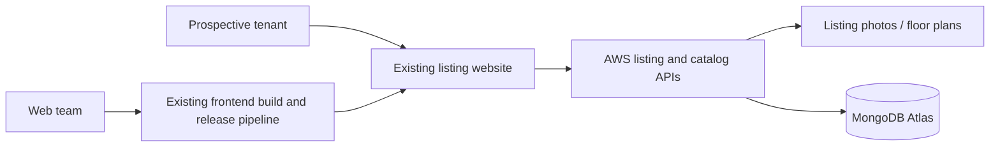
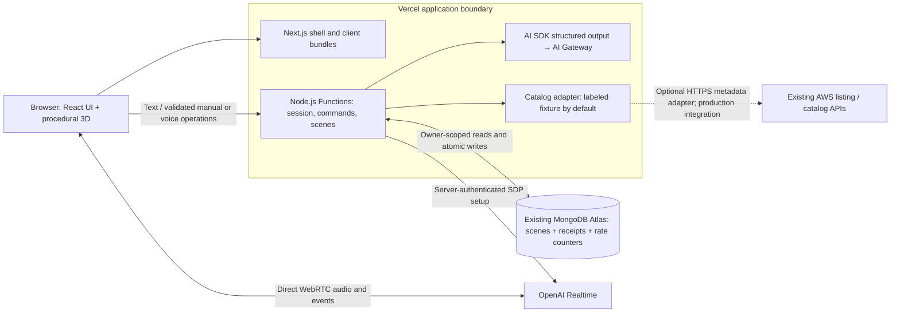

# Architecture and operating decisions

VoxBuild **augments** a rental platform with interactive planning and **connects** that experience to the customer's existing data. It does not require moving listings, catalog ownership, identity, or saved-design storage into a new platform.

## Customer starting point

This is a realistic reference scenario, not a claim about a named customer deployment. Assume listing pages and photos are served by an existing AWS web/API stack; furniture metadata comes from an internal catalog service; MongoDB Atlas stores application documents. Prospective tenants must infer room scale from photos and repeatedly ask whether a sofa or work desk will fit. Product teams also carry bespoke frontend release and model-integration work.

The business hypothesis is that a clearer understanding of a property increases qualified tour requests. That is a pilot hypothesis, not a demonstrated conversion gain. Confirm where the customer currently loses tenants and establish a baseline before proposing a migration.

## Target and implemented slice

The implemented core uses a fixed sample apartment and a catalog fixture; no AWS call occurs unless the optional adapter is configured. The existing-world proof is a real Atlas save and reload when configured. A local sample is explicitly marked and does not satisfy the live-boundary requirement.

| Vercel choice | Customer value | Trade-off and scope |
| --- | --- | --- |
| Next.js on Vercel Functions | One delivery surface for UI and short request handlers; SDK and database access stay server-side | Node.js database connectivity and model waits need regional placement, timeouts, and bounded concurrency. Validate the account's Fluid Compute settings during deployment. |
| AI SDK structured output | A typed plan contract decouples model selection from renderer and persistence | Schema-valid output can still be semantically wrong; domain validation and evaluation remain necessary. |
| AI Gateway | Shared text-model authentication, model routing, fallback configuration, and returned usage/routing evidence | Voice takes a separate direct provider path. Catalog membership does not prove account access or a successful fallback. |
| Preview Deployments | Review the complete change before exposing it to tenants | Preview data and credentials must be isolated; the production canary policy is an operating proposal until exercised. |

Blob and Workflows are intentionally absent from the core. Add Blob for a future photo-upload flow. A durable workflow becomes relevant for long-running reconstruction or human approval, rather than a single bounded furniture edit.

## Rendering, caching, and network placement

Next.js supplies the document/UI shell and JavaScript. The WebGL canvas is dynamically imported with server rendering disabled. The browser draws meshes from validated scene JSON; it does not execute model-generated code or fetch remote GLB assets. Private scene/session/command responses use `no-store`. Public catalog responses use a five-minute shared cache window; the optional external metadata fetch has five-minute revalidation and a catalog tag. This implementation does not claim Cache Components or streamed model output: a complete validated plan is returned before the scene changes.

Place Functions near the selected Atlas region to reduce database round trips; measure the actual deployed path before declaring a region SLA. The demo can cross a public TLS endpoint with an authorized Atlas access list. A production private-network requirement calls for a supported Atlas networking tier and Vercel Secure Compute/static egress design, validated against the customer's cloud, plan, and residency policy. Selecting a Function region alone does not constrain model-provider processing or direct voice geography.

## Command correctness and durability

Every mutation has a scene ID, command ID, expected revision, and up to 12 operations. The shared schema permits only add, move, recolor, rotate, and remove. Dimensions and colors come from a finite versioned catalog. The domain engine rejects unknown SKUs/IDs, unsupported colors, excessive object counts, and rotated furniture outside the room, floor, or ceiling.

The provider-facing schema uses an `anyOf` operation union and plain fields for compatibility across the selected text models and Realtime tools. Descriptions explain the intended bounds, but they are not enforcement. The server parses model output through the strict domain schema before applying any operation or committing state. This separation avoids depending on provider support for every JSON Schema constraint.

The shared store executor loads a scene using the signed session owner, validates a detached copy, and commits the next revision plus command receipt in **one MongoDB document update**. The compare-and-swap filter includes owner, expected revision, and absence of the command ID. Competing writes cannot silently overwrite one another. In that executor, a repeated receipt with the same payload returns the current canonical scene; reusing the ID for a different payload is rejected. The last 128 receipts are retained; an older retry still carries its old revision and cannot reapply after receipt eviction.

Endpoint behavior is narrower than this shared executor guarantee. Manual and voice operations call `/api/commands`; an identical payload retry is idempotent while its receipt is retained. Text calls `/api/scene-agent`, which checks the expected revision **before** generation and receipt lookup. If a text edit committed but its HTTP response was lost, the same request returns `409 REVISION_CONFLICT` on retry. Reload the saved room to recover the accepted state, then issue a new request only if a further change is needed. There is no prompt/result ledger, and the complete text-generation endpoint is not idempotent.

There is no silent storage fallback. A database error retains the last acknowledged browser state and surfaces an error. A request timeout is ambiguous: the write may have committed, so reload the canonical scene before retrying. Accepted scene state survives deployments; an in-progress model generation or WebRTC connection does not. There is no durable agent orchestration or automatic replay of unfinished conversations.

Furniture-to-furniture collisions and circulation clearances are not authoritative server checks. The model receives placement guidance and manual addition searches for a clear spot, but the product remains a conceptual preview. A production fit claim requires verified dimensions, collision/clearance validation, and accessible paths.

## Voice and security

Only an explicit click requests microphone permission. A same-origin authenticated route configures OpenAI and exchanges SDP with the provider; the ordinary API key never reaches the browser. WebRTC then carries media directly. Voice only executes completed, validated function calls, with duplicate suppression and serialized edits. Planning responses are text/tools; an audio continuation is requested after the command acknowledgement. This adds a second Realtime response and latency but prevents the normal workflow from speaking a success before the save result. Server VAD handles barge-in; stale queued speech is suppressed. Disconnect and unmount release microphone tracks. The five-minute browser timer is a UX limit, not an authoritative provider billing cap.

This describes the implemented voice path. An authenticated availability check for `gpt-realtime-2.1` returned HTTP 200 on October 19, 2026; actual microphone negotiation, audio, live tool execution, and interruption still require a browser test with Atlas configured.

Anonymous sessions use a signed, HttpOnly, SameSite cookie and a seven-day expiry. Scene ownership is enforced in database filters. Mutating routes require same origin. Request bodies, operation counts, provider timeouts, and Atlas-backed rate counters are bounded. These controls are appropriate for an isolated public demo; production should add customer identity/authorization, account-wide provider budgets, stronger abuse protection, retention/deletion policy, and audit integration. Anonymous cookie loss means loss of access to that design.

Voice admission is limited to five sessions per hour per visitor and 20 sessions per day globally. Text generation is limited to 40 requests per hour per visitor and 400 per day globally. These admission quotas and the browser's five-minute voice timer are not hard provider-dollar caps. Apply provider/project budgets separately and verify their behavior before a public pilot.

## Rollout and incident plan — proposed

1. **Preview:** deploy each change with a distinct Preview `SESSION_SECRET` and `MONGODB_DB=voxbuild_preview`; Production uses its own secret and `MONGODB_DB=voxbuild`. Verify effective environment scoping before the first release. Run unit/type/build checks, the 14-case live evaluation, and a short browser/microphone check. Inspect usage and latency before promotion.
2. **Pilot canary:** expose the planner to an internal cohort, then a small property/visitor cohort. Use a feature flag or supported Rolling Releases configuration; neither staged traffic control nor statistical experimentation is implemented in this demo.
3. **Cutover:** expand only when error, semantic-success, latency, and cost guardrails hold, and product evidence supports the experience. Existing listing pages remain available throughout.
4. **Rollback:** restore the previous deployment or disable the planner entry point. Stored scenes use `schemaVersion: 1`; keep old and new application versions able to read the same data during rollout. Use additive schema changes and expand/migrate/contract steps. Restoring old code does not undo database changes.
5. **Incident:** if a provider fails, inspect actual Gateway routing metadata. If Atlas fails, stop accepting changes and show the last acknowledged scene. Do not turn an unconfirmed save into a success message. Correlate request/command IDs, assess whether writes committed, and restore service before resuming rollout.

Fallback is configured with `AI_GATEWAY_FALLBACK_MODEL`. On October 19, 2026, a real request to primary `openai/gpt-4.1-mini` succeeded. A separate routing test set `gateway.only: ['google']`, deliberately excluding the primary provider; Gateway selected `google/gemini-2.5-flash` and returned `modelAttemptCount: 2`. This demonstrates policy-driven fallback routing. It does not simulate or prove recovery from a provider outage, timeout, or rate limit.

Read the executed model from `providerMetadata.gateway.routing.canonicalSlug`. In the routing test, `response.modelId` still identified the requested primary, so it is retained as SDK-reported metadata rather than treated as proof of execution. Application telemetry distinguishes requested model, executed model, and SDK-reported model. Application events supply immediate feedback; provider dashboards are a separate verification source.

## Measures to establish

Initial engineering targets, subject to a baseline: at least 90% semantic success on the small command suite, 100% rejection of unsafe domain mutations in deterministic tests, 100% successful save/reload checks in the evaluation run, and p95 text-command response under five seconds in a warm pilot. Measure voice end-of-utterance to visible change separately; set a target after testing the two-response path. Track returned cost per interaction and missing-cost coverage, rather than assuming every failed request is free.

Business evaluation should compare eligible listing visitors who progress to a qualified tour request, alongside engagement, support questions about room suitability, abandonment, and accessibility feedback. Agree experiment duration, sample size, and success threshold with the customer. No conversion, latency, reliability, or cost outcome is claimed until measured.
